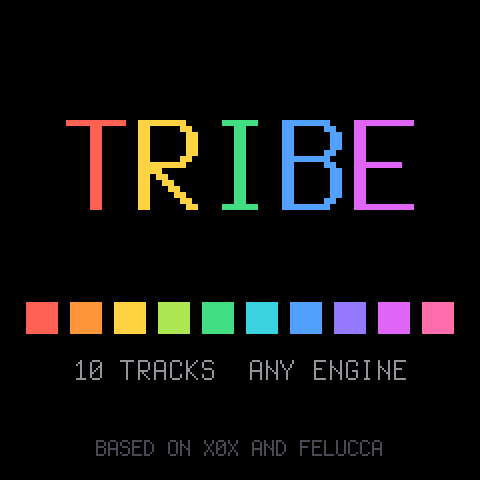
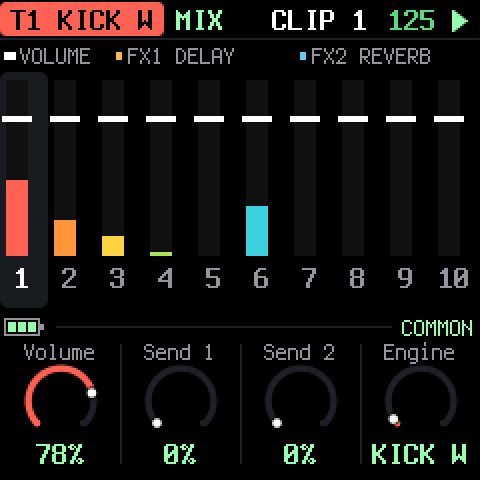

<p align="center"></p>

# TRIBE

Custom firmware for the [M-VAVE FM-1](https://www.m-vave.com): a ten-track groovebox where **any engine
plays on any track**. Kicks, the 909 and 808 voices and ACID, sixty-four clips per track, scatter
effects, two master effects every track sends to, and four master knobs you assign to the volume,
a DJ filter, the effects or the tempo.


## Try it, install it

| | |
|---|---|
| **[Emulator](https://apiel.github.io/fm1-tribe/#emulator)** | TRIBE in the browser, with sound: the same code the FM-1 runs. No FM-1 needed. |
| **[Web installer](https://apiel.github.io/fm1-tribe/#install)** | Flash your FM-1 from Chrome or Edge over USB. Nothing to install on the computer. Can put the stock firmware back. |
| **[Manual](https://apiel.github.io/fm1-tribe/#manual)** | Getting started, every page and every parameter. |
| **[What's new](https://apiel.github.io/fm1-tribe/new/)** | The release notes. |
| **[Discord](https://discord.gg/fzHTbjh6x)** | Questions, bugs, music: the fm1-tribe channel. |
| [Site](https://apiel.github.io/fm1-tribe/) | All of the above on one page. |

Installing firmware is at your own risk; TRIBE is a beta.

## What it looks like

The FM-1's screen, from the same code (the [manual](https://apiel.github.io/fm1-tribe/#manual) shows every page).

<table>
<tr>
<td align="center"><br>Steps and a track's knobs</td>
<td align="center"><br>Ten tracks, a bank of sixteen clips</td>
<td align="center"><br>Engines and the mix</td>
</tr>
<tr>
<td align="center"><br>An engine's sound</td>
<td align="center"><br>Scatter effects</td>
<td align="center"><br>The two master effects</td>
</tr>
</table>

## What it does

- **10 tracks, 28 engines:** two kicks (KICK W, KICK P), the 909 and 808 drum voices, ACID, LEAD, FM4, NOISE.
- **64 clips per track** in four banks of sixteen, launched at the end of the pattern or at once. 16, 32 or 64 steps, six rates, four directions, swing.
- **Scatter effects** on the keys while it plays: loops, reverse, gate, crush, distortion, ring, filters, on a track or the whole mix.
- **FX 1 and FX 2:** reverb, delay, drive, distortion, fuzz, wavefolder, crusher, decimator, ring modulator, chorus, flanger, phaser, tremolo or comb, fed by each track's sends.
- **Four master knobs**, assignable: volume, DJ filter, resonance, FX amounts, BPM.
- Keyboard with arpeggiator and transposition, quantised recording, a synth LFO, an always-on master compressor.

## Build and test

```
tests/run_tests.sh     # host scenarios, audio tests, and the wasm build in node
./run_emu.sh           # build the browser emulator and serve it on http://localhost:8000 (needs Emscripten: ~/emsdk)
tools/flash.sh --build # build build/tribe.fwsc and check that the FM-1 answers; add --yes to install it
```

See [BUILDING.md](BUILDING.md) for the toolchain, the tests and how the site is published, and
[docs/SPEC.md](docs/SPEC.md) for the design decisions.

## Credits and licence

A fork of [X0X](https://github.com/charlesvestal/fm1-x0x) by Charles Vestal (see
[docs/X0X-README.md](docs/X0X-README.md)), which is built on
[Felucca](https://github.com/hugelton/Felucca) by Leo Kuroshita, Hügelton Instruments. The kicks and the
scatter effects come from [zicBox](https://github.com/apiel/zicBox); the 909, 808 and ACID are ports of
9W9, 8W8 and the zicCycle 303 (details in [LICENSING.md](LICENSING.md) and the manual's credits).

GPL-3.0-only. M-VAVE and FM-1 are trademarks of their owners; TRIBE is not connected with M-VAVE,
Roland or Hügelton Instruments.
