# TRIBE

TRIBE turns the M-VAVE FM-1 into a ten-track groovebox. Every track can play any engine: a
kick, a 909 or 808 drum voice, or an ACID bass line. Each track has sixteen clips to launch, you can
add scatter effects while it plays, send tracks to two master effects, and put the master
volume, a DJ filter, the effects or the tempo on the four master knobs.

New in this version: see [What's new](../new/).

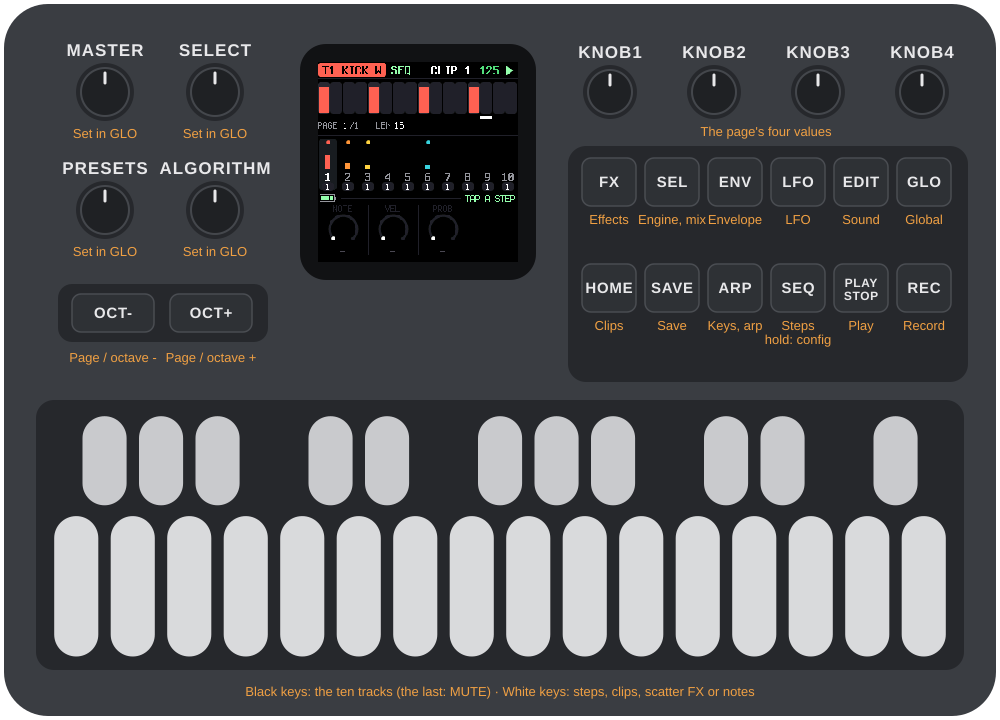

---

## Contents

1. Install
2. Getting started
3. Controls
4. Tracks and engines
5. The sequencer
6. Sound pages and the LFO
7. Clips
8. Scatter effects
9. Keys, arpeggiator and recording
10. The mix: SEL
11. Global settings and the master knobs
12. Saving
13. Troubleshooting
14. Parameters
15. Credits

---

## 1. Install

**Try it first:** the [TRIBE emulator](../emu/) runs the same code in the browser, with sound, played
with the mouse, a touch screen or the keyboard.

**Install:** open the [web installer](../install/) in Chrome or Edge, connect the FM-1 with a USB
data cable and press Install. Don't unplug it while it's writing; when it finishes, the FM-1
restarts into TRIBE.

**Go back:** "Back to the stock firmware", at the bottom of the same page, puts M-VAVE's firmware
back (download the FM-1 V15 file from the link there, choose it, press the button). M-VAVE's own
updater, M-UPGRADE, works too.

> Installing other firmware is at your own risk. If the FM-1 ever won't start, see
> [Recovering an FM-1 that won't start](#recovering-an-fm-1-that-won-t-start).

Your saved clips stay in the FM-1's memory when you install a newer version. The settings (tempo,
levels, effects, knob setup) go back to their defaults after an install that changes how they are
stored; the what's-new page says when that happens.

<details><summary>Install from the command line</summary>

Download the firmware file (for example `tribe-0.1-beta.fwsc`) from the
[releases page](https://github.com/apiel/fm1-tribe/releases), get the TRIBE source from GitHub,
install Python 3 with `pip3 install mido python-rtmidi`, and run:

```
python3 tools/fm1_install.py tribe-0.1-beta.fwsc
```

`tools/flash.sh` does the same for a build you made yourself (see BUILDING.md).

</details>

---

## 2. Getting started

TRIBE starts with a small beat already in it, so there is something to hear straight away.

1. Press **PLAY**. Ten tracks are lined up, and several already have a pattern.
2. Press a black key to pick a track. The black keys are the tracks, 1 to 10, left to right. The
   screen's header names the track and its engine.
3. The white keys are the sixteen steps of the track. Press one to switch a step on, press it
   again to switch it off. Hold an "on" step to edit it: the three or four knobs become its note,
   velocity, probability (and length and slide on an ACID).
4. Press **EDIT**, **ENV** or **FX** to shape the track's sound with the four knobs.
5. Hold the eleventh black key (**MUTE**) and tap a track key to mute or unmute that track.
6. Press **HOME** for the clips: sixteen per track. Press a white key to launch one. It switches at
   the end of the pattern; press it again to switch at once.
7. Press **SEL** for the mix: each track's volume, its two sends and engine.
8. Press **SAVE** when you like what you hear.

---

## 3. Controls

The drawing at the top of the manual names every control. In more detail:

| Control | What it does |
|---|---|
| MASTER | A pot. The master volume until you assign it something else in GLO. |
| SELECT, PRESETS, ALGORITHM | Three encoders, free for you to assign in GLO. By default SELECT is the DJ filter, PRESETS the amount of FX 1 and ALGORITHM the amount of FX 2. |
| OCT-, OCT+ | Page through the steps (SEQ) or the sound pages (FX, ENV, LFO, EDIT). On the keyboard (ARP, REC), the octave. |
| KNOB 1–4 | The four values at the bottom of the screen. |
| FX, ENV, LFO, EDIT | The track's sound, in four groups of parameters. Press the same button again for the next page of four. A button is dark when the engine has nothing in that group. |
| SEL | The mix: volume, sends and engine of every track. |
| GLO | The global settings. |
| HOME | The clips. |
| SAVE | The save pick (see Saving). |
| ARP | The keyboard plays the track; arpeggiator and transposition. |
| SEQ | The steps. Hold it for the sequencer's settings. |
| PLAY | Start and stop. |
| REC | Record notes while it plays. |
| White keys | Steps. On HOME, clips. While it plays on a sound page or GLO, scatter effects. On ARP and REC, notes. |
| Black keys | Tracks 1–10. The eleventh is MUTE. |

A button that opens a screen always opens the same one. The screen's name is in the strip above the
knobs.

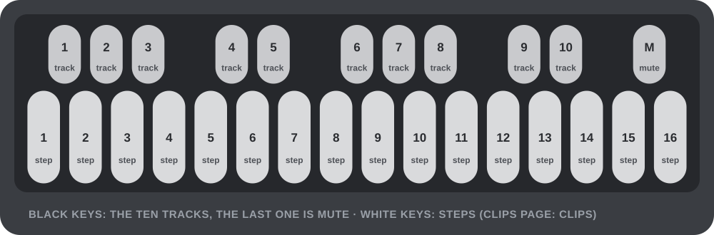

---

## 4. Tracks and engines

There are ten tracks. Each plays one **engine**, which belongs to the clip, so changing clips can
change the engine too. Choose it on the SEL page, with KNOB 4.

| Engine | What it is |
|---|---|
| NONE | An empty track. |
| KICK W | A kick built on a waveform: frequency, FM, folding, harmonics. |
| KICK P | A kick with a morphing oscillator and an FM pair. |
| 909 BD, SD, LT, MT, HT, RS, CP, CH, OH, CR, RD | The 909 voices: kick, snare, three toms, rim, clap, closed and open hat, crash, ride. |
| 808 BD, SD, LT, MT, HT, RS, CP, CB, CY, OH, CH | The 808 voices: kick, snare, three toms, rim, clap, cowbell, cymbal, open and closed hat. |
| ACID | The bass synth: the zicCycle 303, with accent, slide, a colour and a pitch envelope, and its LFO. |
| FM4 | A mono 4-operator FM synth laid out like the Digitone's FM: operators C, A and B1/B2, eight algorithms with two outputs (X and Y, mixed by MIX), HARM and DTUN, two envelopes with end levels, a filter and an overdrive. |
| NOISE | A mono synth built on noise: an oscillator that morphs through square, noise, saw, noise and tri, over a noise floor that is always there (white, pink or brown), then a filter (LP, HP, BP or notch) with key tracking, and an envelope. |

Every drum engine is pitched: the note of a step changes its tune, which is what makes the kicks
useful. A synth step has a note, a velocity, a length and a slide.

A voice exists once. Each 909 and 808 voice can be on one track at a time (a second track that picks
a voice already in use shows **BUSY** in the header and stays silent), there are two ACIDs, two LEADs and
three kicks (KICK W and KICK P share them).

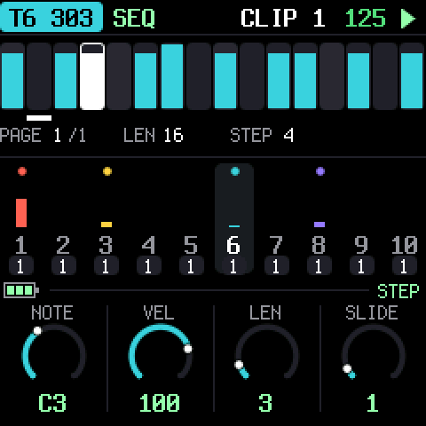

---

## 5. The sequencer

Press **SEQ**. The sixteen white keys are the steps of the selected track, with the step the track is
playing lit. Press a key to switch a step on or off. **Hold** an "on" step (about a third of a
second) and it stays selected: the knobs become that step's.

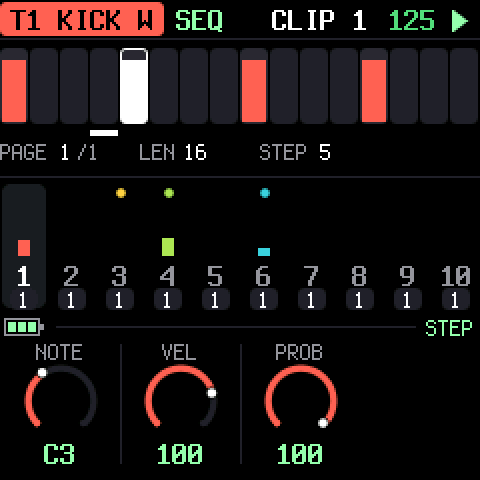

- **Drums:** NOTE, VELOCITY, PROBABILITY (the chance it plays, 0–100%).
- **ACID:** NOTE, VELOCITY, LENGTH (in quarter steps), SLIDE (the note glides into the next).

With no step selected the knobs are greyed and do nothing. A track can be **16, 32 or 64 steps**;
OCT- and OCT+ page through them, sixteen at a time.

**Hold SEQ** (about half a second) for the sequencer's settings of the clip, saved with it. Let go
to go back to the steps.

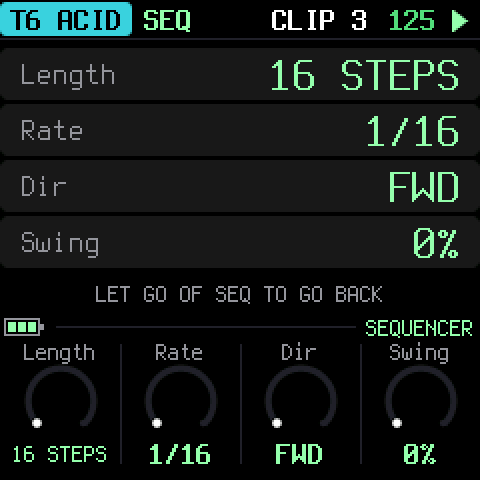

| Setting | Values |
|---|---|
| LENGTH | 16, 32 or 64 steps |
| RATE | 1/16, 1/8, 1/32, and the triplets 1/16T, 1/8T, 1/32T |
| DIRECTION | forward, reverse, ping-pong, random |
| SWING | 0–100%: the second step of each pair is late |

Each track runs on its own clock, so a 1/32 hat can play over a 1/8 bass. A queued clip takes over
when the track's pattern ends, in whatever direction it plays.

---

## 6. Sound pages and the LFO

**FX, ENV, LFO and EDIT** show the parameters of the selected track's engine in four groups. The
four knobs edit the page; the name and value are under each knob. When a group has more than four
parameters there are dots in the strip and OCT-/OCT+ (or pressing the button again) flip pages.

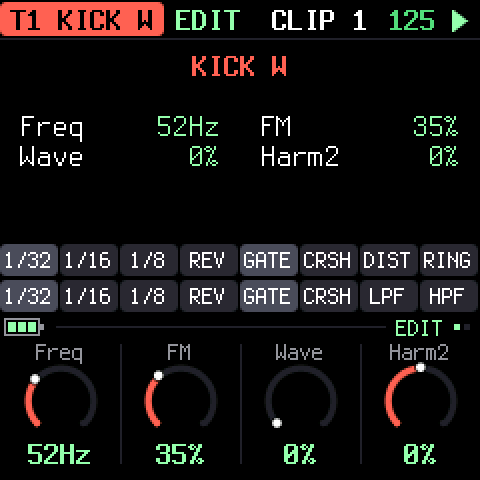

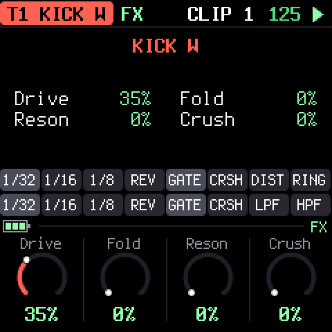

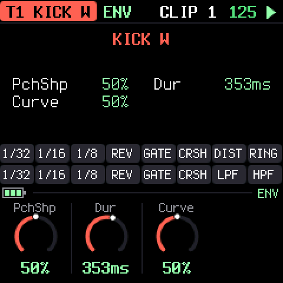

What each engine has is listed in section 14. Parameters belong to the **clip**: switch clips and the
sound switches with it.

**LFO** (the synths only, ACID and LEAD, since a drum hit is too short for one) is a modulation of one of the
engine's parameters. There is one per clip, saved with it.

| Control | |
|---|---|
| SHAPE | sine, triangle, saw, square, random |
| RATE | synced to the tempo (1/64 to 8 bars) or free (0.05–25 Hz) |
| DEPTH | 0 is off; at full the parameter moves half its range each way |
| TARGET | the parameter it moves |
| SYNC | on: tempo-synced; off: free |
| RETRIG | restart on every note (with random: a new value on every note) |

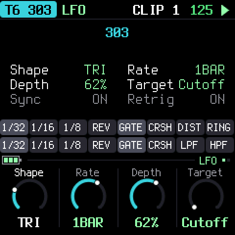

---

## 7. Clips

Press **HOME**. Each track has **sixteen clips**; a clip holds everything of the track: pattern,
engine, sound, LFO and sequencer settings. The grid shows ten rows (the tracks) of sixteen
(the clips); a filled square is a clip with notes in it, the playing one is lit.

The white keys launch a clip of the selected track:

- The first press **queues** it (it blinks) and it takes over at the end of the pattern.
- Press the same key again while it is queued to switch **at once**.

KNOB 1 on this page is the track's level.

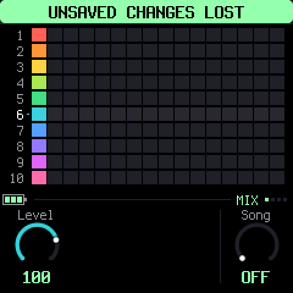

> **Changed and not saved?** If you edit a clip, leave it and launch it again before saving, it
> comes back as it was last saved. Save first (or save with the pick) to keep an edit.

---

## 8. Scatter effects

While it **plays**, the second row of keys on a sound page (FX, ENV, LFO, EDIT), on SEL or on GLO is not for notes
but for **scatter effects**, held for as long as you press. The first eight act on the selected
track, the last eight on the whole mix:

| Keys 1–8 (the track) | Keys 9–16 (the mix) |
|---|---|
| 1/32, 1/16, 1/8: a loop of that length | 1/32, 1/16, 1/8: a loop of that length |
| REV: reverse | REV: reverse |
| GATE: chop | GATE: chop |
| CRSH: bit crusher | CRSH: bit crusher |
| DIST: distortion | LPF: a low-pass filter |
| RING: ring modulator | HPF: a high-pass filter |

One effect at a time per scope. Stopped, the same keys audition the track's notes.

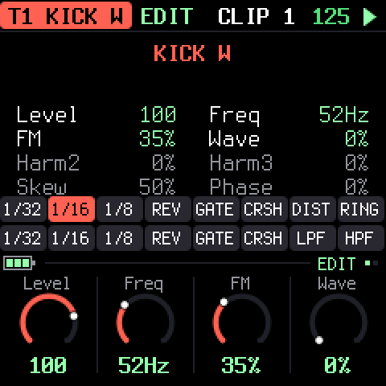

---

## 9. Keys, arpeggiator and recording

**ARP** turns the whole keyboard into a keyboard for the selected track, from F3 to G5; OCT- and
OCT+ move it up and down. The first knob chooses a mode:

| Mode | |
|---|---|
| KEYS | Plain keyboard. |
| UP, DOWN, UPDN, RAND | The held keys arpeggiate (with PLAY). RATE (1/16, 1/8, 1/4), GATE and OCT (octaves) are the other knobs. |
| TRSP | Transposition: a key is a number of semitones from middle C (the dot). The track's sequence plays transposed until the next key. Leaving TRSP puts it back. |

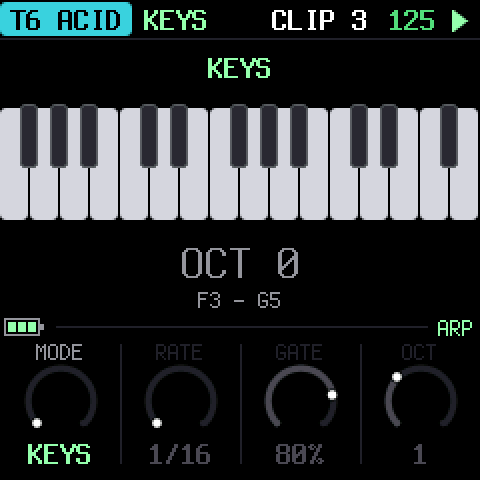

**REC** gives the keyboard to the selected track too, and while the track plays it **records**: a
note goes into the nearest step of the track's pattern (a drum hit, or an ACID note whose length is
how long you held the key). Stopped, REC just plays.

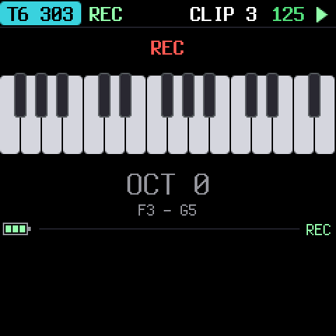

---

## 10. The mix: SEL

**SEL** is the page of what every track has. Each track is a column: the wide bar is its live level
(after the volume and the mute), the white tick the volume, and the two thin bars its sends.
Black keys pick the track. The white keys work as on the other sound pages: they play the track when
it is stopped, and are the scatter keys while it plays.

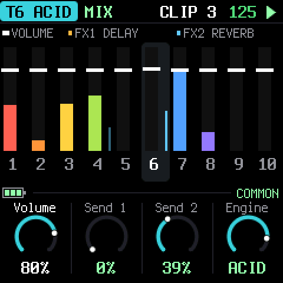

| Knob | |
|---|---|
| VOLUME | the track's level |
| SEND 1 | how much goes to FX 1 |
| SEND 2 | how much goes to FX 2 |
| ENGINE | which engine the clip on this track plays |

The sends start closed. **FX 1 and FX 2** are two master effects (chosen in GLO, next section): raise
a track's send to put it in the echo or the room. Sends are after the volume and the mute.

---

## 11. Global settings and the master knobs

**GLO** is a list; KNOB 1 scrolls, KNOB 2 changes the value of the row.

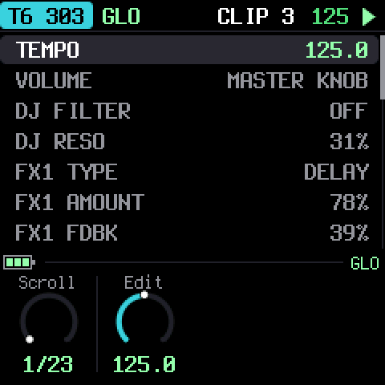

| Row | |
|---|---|
| TEMPO | 30–300 BPM |
| VOLUME | The master volume. It counts when the MASTER knob is not the volume; otherwise the row says MASTER KNOB. |
| DJ FILTER | One knob: low-pass to the left, high-pass to the right, off in the middle |
| DJ RESO | The DJ filter's resonance |
| FX1 TYPE, FX1 AMOUNT, FX1 PARAM | The first master effect: what it is, its return level and its own control |
| FX2 TYPE, FX2 AMOUNT, FX2 PARAM | The same for the second |
| MASTER / SELECT / PRESETS / ALGO KNOB | What each of the four knobs does |
| COMP THRESH … COMP MIX | The master compressor |
| CLIPS | How many clips are unsaved |
| CPU | The audio's load, and its peak |
| BATTERY | The charge, or USB POWER |

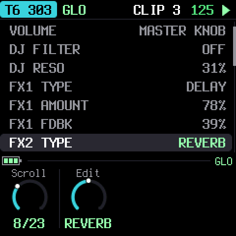

### FX 1 and FX 2

Each of the two master effects is one of:

| Type | PARAM is |
|---|---|
| REVERB | SIZE of the room |
| DELAY | FEEDBACK (a dotted eighth, darker with every repeat) |
| DRIVE | how hard it is driven (a soft clip) |
| DISTORT | how hard it is driven (a hard clip) |
| FUZZ | the fuzz (lopsided clipping) |
| WAVSHAPE | the fold of a wavefolder |
| CRUSH | the bits and the sample rate |
| DECIM | the sample-rate reduction |
| RING | the ring modulator's frequency, 40 Hz–2 kHz |

**AMOUNT** is how much of the effect returns to the mix. The reverb and the delay have one
buffer each, so only one of the two slots can be a reverb and only one a delay.

### The four knobs

MASTER (a pot) and SELECT, PRESETS and ALGORITHM (encoders) each do one of:

**VOLUME · DJ FILTER · DJ RESO · FX1 AMOUNT · FX2 AMOUNT · BPM**

Choose in GLO with KNOB 2 on the knob's row. A knob and the GLO row of the same name are one value:
turn either. BPM on an encoder moves one BPM a click; on the pot, 30 to 300.

The factory setup: MASTER volume, SELECT the DJ filter, PRESETS FX 1's amount, ALGORITHM FX 2's.
The DJ filter acts on the whole mix.

### The compressor

The master compressor is always on, then a limiter. GLO has its threshold, ratio, attack,
release, makeup and mix. The defaults are a gentle glue: -12 dB, 2:1, 8 ms, 110 ms, +2 dB.

---

## 12. Saving

Nothing is saved on its own. The **SAVE** light glows when something has changed.

Press **SAVE** and a pick opens on the screen. Every other button goes dark, SAVE glows at half, and
what can be saved blinks:

- the **track keys** whose clip on screen has changed,
- **GLO**, if the global settings have changed.

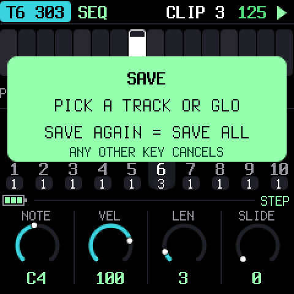

Press a blinking **track key** to save that clip, or **GLO** to save the settings. Press **SAVE
again** to save everything that changed, including clips that are not on screen. Any other button
or key cancels. With nothing to save, SAVE only says so.

The setting the **MASTER knob** is doing is never saved (its volume, if it is the volume): the pot
is a position, and TRIBE reads it when it starts. Everything else on GLO is saved, the volume
included when MASTER does something else.

Clips are saved to the FM-1's flash, one at a time, only the ones that changed. If the power is cut
in the middle of a save, the previous version of the clip is still there.

---

## 13. Troubleshooting

**Update mode:** hold OCT- and OCT+ together for five seconds. A countdown appears; let go
before it ends to cancel.

**Calibration:** if a button or knob does the wrong thing, hold OCT- and OCT+ while you switch
the FM-1 on. The screen then asks you to press each button and turn each knob in turn.

**Questions and bugs:** join the [fm1-tribe Discord](https://discord.gg/fzHTbjh6x) or [open an issue](https://github.com/apiel/fm1-tribe/issues).

**It's crackling or cutting out:** look at CPU in GLO while everything plays. Ten tracks of ACIDs
and kicks is a lot for the FM-1; turn tracks to NONE or to simpler engines if the peak reaches 100%.

**After a crash:** TRIBE shows a red CRASH screen and restarts by itself a few seconds later. The
next start shows RESTARTED AFTER A CRASH and an address (PC ...) for a moment. If you report the
problem, include that address and what you were doing.

**Safe mode:** if TRIBE crashes twice in a row while starting, it starts in SAFE MODE instead. There's
no sound, but USB works, so the web installer can reach it: reinstall TRIBE, or put the stock
firmware back from the same page. Press PLAY to try starting TRIBE normally again. If even safe
mode fails twice, the FM-1 drops into the chip's own update mode, and only the rescue below can
reach it.

### Recovering an FM-1 that won't start

If the FM-1 is in the chip's own update mode (a blank screen after crashes), neither the web
installer nor M-VAVE's updater can see it, but a script can put M-VAVE's firmware back, on a Mac,
with the USB cable you already have:

Open Terminal, paste this line and press Return:

```
bash -c "$(curl -fsSL https://raw.githubusercontent.com/apiel/fm1-tribe/main/tools/fm1_rescue.sh)"
```

1. If a window asks to install the command line developer tools, click Install. When it has
   finished, paste the line again.
2. If it asks for a password, type your Mac password (nothing shows as you type) and press Return.
3. When it says it's waiting, plug the FM-1 in and switch it on. It crashes and goes blank, and
   the script catches it. It checks the chip, saves a backup of the FM-1's memory in the
   `fm1-rescue` folder in your home folder, and asks before it writes anything.
4. Type **yes** and press Return. Don't unplug anything until it says it's restarting the FM-1.
   The FM-1 then starts into its original firmware, and you can install TRIBE again from there.

The script downloads M-VAVE's FM-1 V15 firmware and JieLi's flash loader, and checks both against
known fingerprints. It writes only the firmware area of the memory, never the bootloader or the
FM-1's own settings, and checks everything it writes. Running it again is always safe. If it fails,
copy everything in the Terminal window and
[open an issue](https://github.com/apiel/fm1-tribe/issues). If the FM-1 never shows up at
all, Felucca's [FM-1-transporter](https://github.com/kurogedelic/FM-1-transporter) (a small
RP2040 board wired to the USB lines) can still reach it.

---

## 14. Parameters

What each engine's four groups hold, page by page (four knobs a page). Ranges are what the knob
shows; every knob is 0–127 underneath.

| Engine | FX | ENV | EDIT |
|---|---|---|---|
| KICK W | Drive, Fold, Reson, Crush | PchShp, Dur, Curve | Freq, FM, Wave, Harm2, Harm3, Skew, Phase |
| KICK P | Drive, Wfold, Reson, Crush, Boost | Dur, SwpShp, SwpDpt, FMSnap | Freq, Morph, FMDpt, FMRat |
| 909 BD | Drive, Dist | Attack, Decay, P.Dpth, Pitch | Tune |
| 909 SD | Drive, Dist | (none) | Tune, Tone, Snappy |
| 909 LT, MT, HT | Drive, Dist | Decay, Attack | Tune |
| 909 RS | Drive, Dist | (none) | Tune |
| 909 CP | Drive, Dist | Tail | Tune |
| 909 CH, OH, CR, RD | Drive, Dist | Decay | Tune |
| 808 BD | Drive, Dist | Decay, Attack | Tone, Tune |
| 808 SD | Drive, Dist | Decay | Tone, Snappy, Tune |
| 808 LT, MT, HT, RS | Drive, Dist | Decay | Tune, Sound |
| 808 CP | Drive, Dist | Decay, Attack | Tune, Sound |
| 808 CB, CY, OH, CH | Drive, Dist | Decay | Tune |
| ACID | Drive, Dist, DrvTyp | Decay, EnvMod, P.Dpth, Slide, Sustain | Cutoff, Reso, Color, Accent, Tune |
| LEAD | Drive, Dist, DrvTyp, Ring, RingFq | Attack, Decay, Sustain, Release, EnvMod, Slide | Cutoff, Reso, Color, Detune, Unison, Sub, Tune |
| FM4 | Drive, Trig | Atk A, Dec A, End A, Lev A, Atk B, Dec B, End B, Lev B, Attack, Decay, Sustain, Release | Alg, Ratio C, Ratio A, Ratio B, Harm, Detune, Feedbk, Mix, Cutoff, Reso |
| NOISE | Drive | Attack, Decay, Sustain, Release, EnvMod | Morph, Noise, NType, Tune, FType, Cutoff, Reso, KeyTrk |

ACID, LEAD, FM4 and NOISE also have the LFO page (section 6). The track's level is VOLUME on SEL (with the two sends), and KNOB 1 on CLIPS; no sound page has a level of its own.

---

## 15. Credits

TRIBE is free software under the GNU General Public License, version 3. If you share the
firmware, you must also share its source code.

- TRIBE is a fork of **X0X** by Charles Vestal, which is built on **Felucca** by Leo Kuroshita,
  Hügelton Instruments: the hardware layer, USB, update loader, installer and storage.
- The kicks (KICK W and KICK P) and the scatter effects are from **zicBox** by apiel.
- The 909 is from **9W9** by athousanddetails, which is based on **ER-99** by Matthew
  Cieplak. Its hat and cymbal samples are ER-99's.
- The 808 is from **8W8** by athousanddetails.
- ACID is a port of the **zicCycle 303** (Model:Cycles, by apiel), in float.
- The fonts are Barlow Semi Condensed and Terminus (SIL Open Font License).

M-VAVE and FM-1 are trademarks of their owners, and TR-808, TR-909 and TB-303 are Roland
trademarks. TRIBE is not connected with M-VAVE, Roland or Hügelton Instruments.
